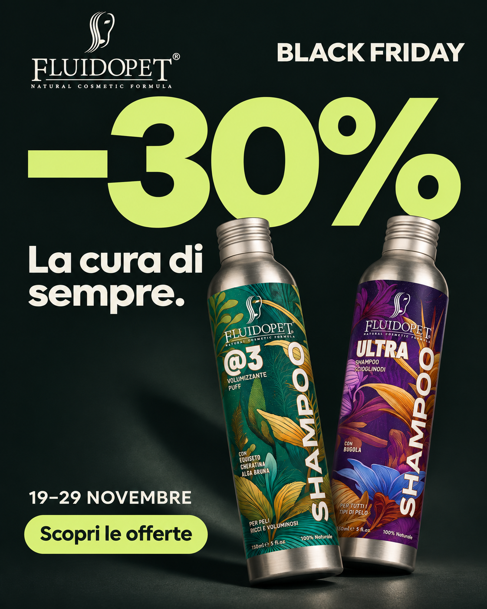
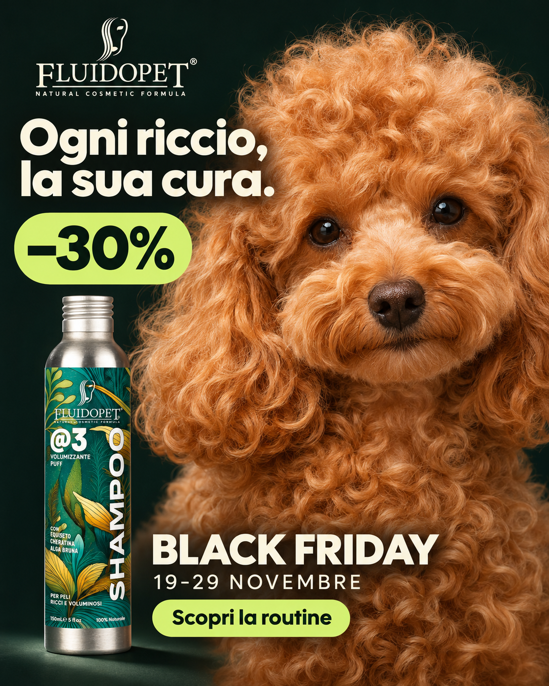
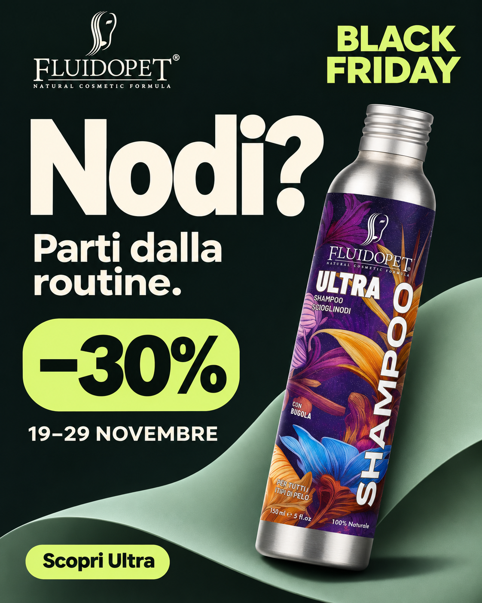
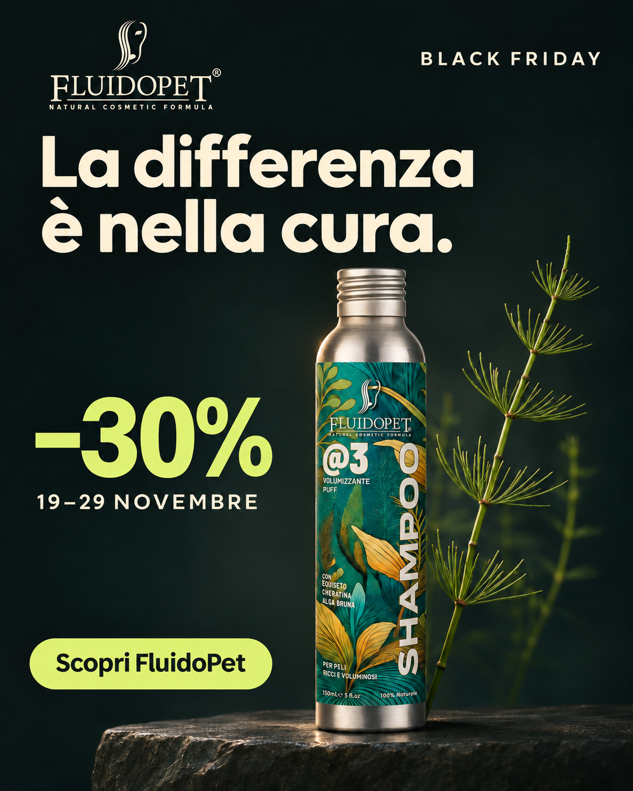
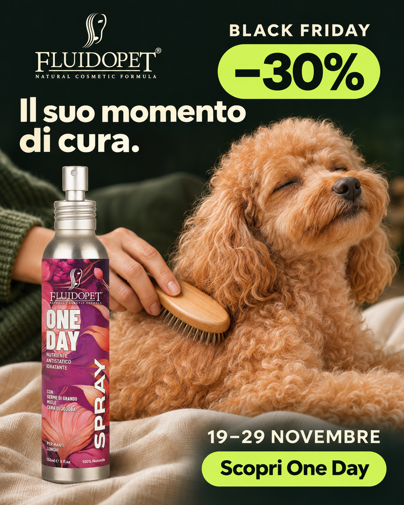
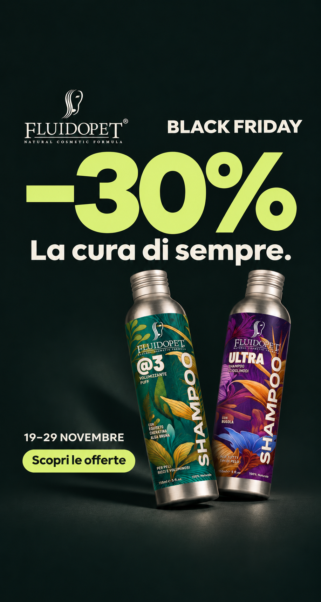
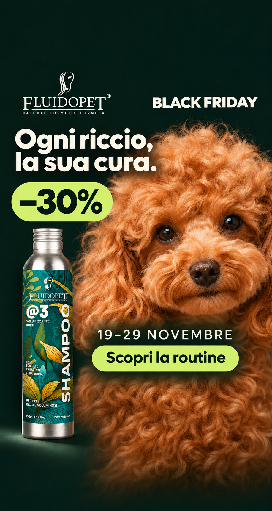

<!doctype html><html lang="it"><head><meta charset="utf-8"><meta name="viewport" content="width=device-width,initial-scale=1"><title>FluidoPet — Proposte social Black Friday 2026</title></head><body><main><header>
FluidoPet · Black Friday 2026
<h1>Natural Care. Dark Edition.</h1>
Una nuova serie di reference pensate per la lettura su smartphone: immagini dominanti, messaggi brevi e offerta immediata.

–30% · 19–29 novembre5 proposte feed2 proposte StoriesLogo flat
</header><nav aria-label="Filtra le reference"><button class="active" data-filter="all" aria-pressed="true">Tutte</button><button data-filter="feed" aria-pressed="false">Feed</button><button data-filter="story" aria-pressed="false">Stories</button></nav><section class="grid"><article data-type="feed">
01 / Offerta immediata<h2>Offer First</h2>
Per l’apertura della promozione e i messaggi più diretti.

Scelta creativa

Lo sconto guida la lettura. Due flaconi grandi rendono subito riconoscibile la categoria.

<a class="download" href="immagini/01-offer-first-feed.png" download>Scarica PNG ↗</a>
</article><article data-type="feed">
02 / Visual principale<h2>Curly Care</h2>
Per raggiungere chi vive con un barboncino o un cane dal pelo riccio.

Scelta creativa

Sguardo e texture del pelo catturano l’attenzione; il prodotto collega l’emozione alla routine.

<a class="download" href="immagini/02-curly-care-feed.png" download>Scarica PNG ↗</a>
</article><article data-type="feed">
03 / Bisogno specifico<h2>Problem / Solution</h2>
Per introdurre Ultra attraverso il tema dei nodi.

Scelta creativa

Una domanda breve apre il messaggio. Il prodotto domina la scena senza mostrare risultati inventati.

<a class="download" href="immagini/03-problem-solution-feed.png" download>Scarica PNG ↗</a>
</article><article data-type="feed">
04 / Valore del prodotto<h2>Natural Expertise</h2>
Per raccontare il posizionamento naturale e professionale.

Scelta creativa

Flacone, luce e un richiamo botanico costruiscono la qualità percepita. L’equiseto richiama il pack Puff.

<a class="download" href="immagini/04-natural-expertise-feed.png" download>Scarica PNG ↗</a>
</article><article data-type="feed">
05 / Routine e relazione<h2>Everyday Care</h2>
Per raccontare One Day attraverso un momento quotidiano.

Scelta creativa

Il gesto della spazzolatura e il cane rilassato danno un contesto alla cura. Un solo prodotto in primo piano.

<a class="download" href="immagini/05-everyday-care-feed.png" download>Scarica PNG ↗</a>
</article><article data-type="story">
06 / Composizione verticale<h2>Offer First · Stories</h2>
Adattamento della promozione al formato Stories.

Scelta creativa

Il blocco di messaggio scende nella fascia centrale. La scena prosegue sopra e sotto per accogliere l’interfaccia.

<a class="download" href="immagini/06-offer-first-story.png" download>Scarica PNG ↗</a>
</article><article data-type="story">
07 / Composizione verticale<h2>Curly Care · Stories</h2>
Adattamento del visual principale al formato Stories.

Scelta creativa

Il volto rimane centrale. Data e invito all’azione sono rialzati e leggibili sotto il muso.

<a class="download" href="immagini/07-curly-care-story.png" download>Scarica PNG ↗</a>
</article></section><section class="notes"><h2>Da dove partire</h2>
<strong>Curly Care</strong> come visual principale, <strong>Offer First</strong> per la comunicazione più diretta della promozione. Le altre tre proposte ampliano i messaggi con bisogno, prodotto e routine. Sono ipotesi creative da confrontare, senza previsioni di rendimento.

Queste immagini sono reference creative generate con AI a partire dal logo fornito e dai packshot dei prodotti. Per gli esecutivi utilizzare logo e packshot originali, Outfit e DM Sans, impaginando a <strong>1080 × 1350</strong> e <strong>1080 × 1920</strong>. I PNG conservano la risoluzione nativa della generazione.

<a href="Indicazioni-per-la-grafica.md">Indicazioni per la grafica e calendario →</a> <a href="Prompt-creativi.txt">Prompt completi delle reference →</a>
</section><footer>FluidoPet · Revisione della direzione visiva · 16 novembre 2026</footer></main></body></html>
